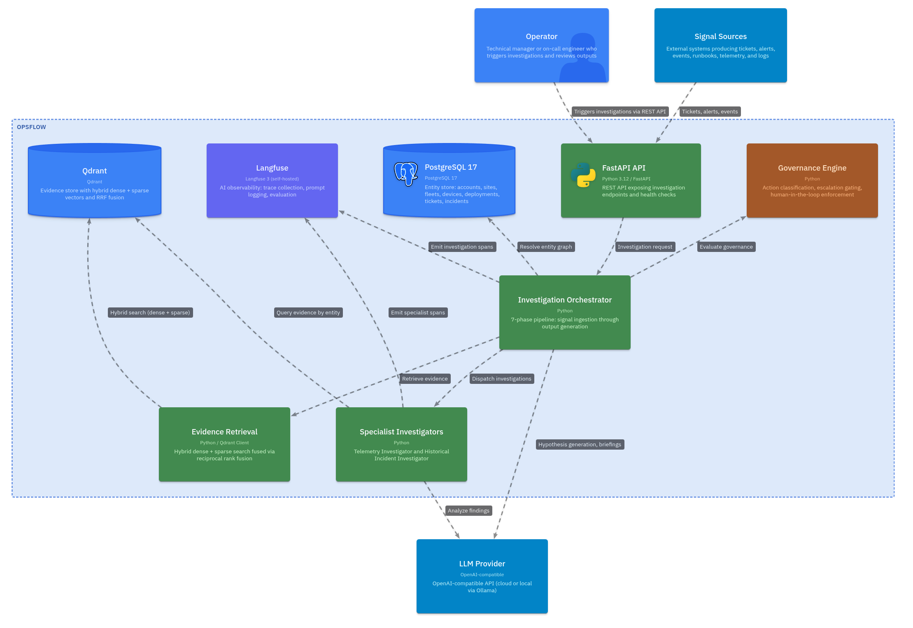

# OpsFlow

**An incident investigation layer that converges signals from several sources into one governed investigation over an entity graph.**

> **Status:** personal open-source alpha. Runs today on synthetic data over real Postgres and Qdrant, with a fresh-clone quick start that works and output restrictions the governance engine actually enforces. Being pointed at a real self-hosted service estate — see [where this is going](#where-this-is-going). Not for production use.

## Why this exists

During an incident, the information needed to understand it is scattered across alerts, uptime checks, deployment history, telemetry, runbooks and past tickets. A human stitches those together manually, under time pressure, and the connection that matters — this started six minutes after that rollout — is often the one nobody makes in time.

OpsFlow reconstructs that context. It runs a fixed seven-phase pipeline that converges multiple signals into a single investigation, resolves them against an entity hierarchy, retrieves evidence, consults specialist investigators, and produces bounded outputs with a full trace of how it got there. Humans stay in control of execution: the system investigates and recommends, it does not act.

## What this is / is not

**Is:**

- An investigation layer that sits on top of existing tools rather than replacing them
- A structured seven-phase pipeline with typed inputs and outputs at every stage
- A governance-bounded reasoning system — EXECUTE actions are blocked
- A personal open-source project, built on personal time with personal infrastructure

**Is not:**

- A platform replacement
- A production system — no security review, no real data handling, no SLA
- An autonomous remediation tool
- Built from any company's real data, workflows, or operational patterns

## Where this is going

The v1 pipeline is architecturally complete and empirically hollow. It runs end to end, but over invented data, with several components simulated — see [what is simulated](#what-is-simulated-or-stubbed) below. Every one of those simulations is a consequence of having no real signal source, not of a design flaw.

So the current work points the same architecture at a real self-hosted estate of around twenty containerised services, and migrates the workload onto a k3s cluster provisioned with Terraform. That estate supplies real versions of every signal the architecture already models — including the one that was hardest to fake convincingly, deployment adjacency, because every image is pinned by digest and every deployment is a git commit.

The plan is in [`.sisyphus/plans/opsflow-homelab.md`](.sisyphus/plans/opsflow-homelab.md).

## What works today

- Seven-phase investigation pipeline runs end-to-end: signal ingestion, entity resolution, evidence retrieval, specialist investigation, hypothesis generation, governance evaluation, output generation
- Entity model with 10 types: Account, Site, Fleet, Device, Service, Deployment, SoftwareRevision, Incident, Ticket, OperationalEvent
- Entity resolution is database-backed: signals are looked up in Postgres and resolved against the entity graph from their foreign keys; unknown signal IDs get a 404 naming them, not an unrelated incident
- Hybrid retrieval against real Qdrant (dense + sparse, RRF fusion) returns the seeded evidence; a failed retrieval surfaces as a 503, never as a successful empty investigation
- Governance engine classifies actions into 5 categories (INVESTIGATE, RECOMMEND, ESCALATE, COMMUNICATE, EXECUTE), blocks EXECUTE in v1, gates by severity/confidence/sensitivity — and its decisions are enforced on the outputs: a customer response draft is emitted only when the classification approves it, never when it is blocked, and no draft ever claims a root cause or promises a resolution time the evidence does not support
- Three disjoint synthetic scenarios seed together (strong-evidence escalation, weak-evidence output restriction, evidence-grounded customer communication) so the distinct paths can be verified against each other
- Schema management via Alembic migrations applied on API startup; a fresh clone migrates and seeds without manual steps
- Docker Compose minimal stack (API, Postgres, Qdrant) comes up healthy by default; Langfuse, Prometheus and Grafana run behind an optional `--profile observability`
- FastAPI endpoints: `GET /healthz`, `POST /seed`, `POST /investigations` (404 unknown signal IDs, 503 on dependency failure)
- Two specialist investigators: Telemetry (generic baseline-deviation detection) and Historical Incident (pattern matching, deployment adjacency)
- CI runs the unit suite plus an integration suite against real Postgres and Qdrant service containers
- Langfuse trace emission for every investigation phase — prompts, evidence, hypotheses, governance decisions are all inspectable when the observability profile is enabled

## What is simulated or stubbed

- **Dense vectors are deterministic hashes, not real embeddings.** Qdrant receives 384-dim vectors generated by SHA-256 of document IDs. The RRF fusion architecture is real; the dense vectors are not semantically meaningful. Embedding provider integration is a planned next step.
- **Sparse vectors are word-count bags, not BM25.** Tokens map to vector indices through a shared deterministic hash used identically at index and query time, so keyword overlap genuinely matches — but scoring is term-frequency only, not BM25 quality.
- **Specialist analysis is rule-based.** The telemetry investigator detects any `metric: value (baseline: ...)` deviation generically; the historical investigator matches generic patterns (post-update rollback, sensor/latency, customer impact). LLM-enhanced analysis is supported but optional — the system defaults to rule-based logic.
- **All evidence is synthetic.** The 19 evidence documents across three fixture scenarios (historical tickets, runbooks, telemetry snapshots, deployment manifests) are invented. They exist as fixtures to exercise the pipeline, not as a demonstration of a domain. No real operational data enters the system.

## Connect rather than replace

OpsFlow is designed to sit on top of existing tools — ticketing systems, documentation, telemetry platforms, code repositories, communication channels — not replace them. The architecture assumes connectors to these systems that feed signals and evidence into the investigation pipeline.

Today's connectors are stubs against synthetic data. The entity model, retrieval layer, and governance engine are built to accommodate real integrations, but none are wired yet. This is the primary gap between the current alpha and a useful tool.

## Architecture

Architecture diagrams are maintained as a LikeC4 model in [docs/architecture](docs/architecture/README.md).



The model covers the system context, container view, seven-phase investigation flow, and observability stack. The interactive architecture site is published at:

https://cgracia.github.io/opsflow/

## Quick start

```bash
git clone https://github.com/cgracia/opsflow.git && cd opsflow
cp .env.example .env
# Works with no keys at all: the system runs rule-based and without tracing.

docker compose up -d          # API + Postgres + Qdrant (healthy in ~30s)
# docker compose --profile observability up -d   # optional: Langfuse, Grafana

# Verify the API is healthy
curl -sf http://localhost:8000/api/v1/healthz

# Migrations run on startup; seed three synthetic scenarios
curl -sf -X POST http://localhost:8000/api/v1/seed

# Investigate scenario A (strong evidence, high severity → ESCALATE,
# customer draft withheld)
curl -sf -X POST http://localhost:8000/api/v1/investigations \
  -H 'Content-Type: application/json' \
  -d '{"signal_ids": {"ticket_id": "TCK-1001", "alert_id": "ALT-2001", "event_id": "EVT-3001"}}'

# Unknown signal IDs are rejected — they do not resolve to unrelated incidents
curl -s -X POST http://localhost:8000/api/v1/investigations \
  -H 'Content-Type: application/json' \
  -d '{"signal_ids": {"ticket_id": "NOPE-1"}}'
# → 404 {"detail":"Unknown signal IDs: ticket_id 'NOPE-1'"}
```

Ports: API at `:8000`, Qdrant at `:6333`, Postgres at `:5432`. With the observability profile: Langfuse at `:3000`, Grafana at `:3100`.

The response is a full `InvestigationResponse`: entity context resolved from the signals, evidence retrieved, specialist reports, hypotheses, governance decision, the operator briefing, and a customer draft only when governance approves one. See [the fixture scenarios](#fixture-scenarios).

## Fixture scenarios

Three disjoint synthetic scenarios seed together, each exercising a different governance shape:

| Scenario | Signals | Evidence | Governance outcome |
|----------|---------|----------|--------------------|
| A — Meridian Logistics navigation regression | `TCK-1001`, `ALT-2001`, `EVT-3001` | 11 documents, telemetry + deployment adjacency | ESCALATE (high severity, enterprise) — escalation flagged, customer draft withheld |
| B — Northwind Cold Chain sensor drift | `TCK-2001`, `EVT-4001` | 2 vague documents, no telemetry | INVESTIGATE with restricted outputs — drafts blocked below 0.3 confidence, no root-cause claims |
| C — Atlas Retail Robotics scanner misreads | `TCK-3001`, `ALT-4002`, `EVT-4002` | 6 documents, strong correlation | COMMUNICATE (medium severity, enterprise) — evidence-grounded customer draft emitted |

Scenario A is written up in detail in [docs/demo-scenario.md](docs/demo-scenario.md).

## Investigation flow

Every investigation follows seven fixed phases, executed in order:

1. **Signal Ingestion.** Receive ticket, alert, and event identifiers. Validate and normalize into a unified signal set.
2. **Entity Resolution.** Map signals to the affected entity graph: Account, Site, Fleet, Device, Service, Deployment, SoftwareRevision.
3. **Evidence Retrieval.** Query Qdrant with hybrid search (dense + sparse, fused via RRF), filtered by entity IDs and source types.
4. **Specialist Investigation.** Dispatch to domain-specific investigators. Telemetry Investigator analyzes device metrics. Historical Incident Investigator searches past incidents, runbooks, and deployment records.
5. **Hypothesis Generation.** Synthesize evidence, telemetry findings, and historical patterns into ranked hypotheses with confidence scores.
6. **Governance Evaluation.** Classify the action (INVESTIGATE, RECOMMEND, ESCALATE, COMMUNICATE, EXECUTE). Block EXECUTE. Gate sensitive operations. Flag escalation for high-severity customer-facing incidents.
7. **Output Generation.** Produce outputs bounded by the governance decision: an internal operator briefing always, and a customer-safe response draft only when the classification approves it — never when blocked, never claiming more than the evidence supports.

## Stack

| Component | Technology |
|-----------|-----------|
| API | Python 3.12, FastAPI, Pydantic v2 |
| ORM | SQLAlchemy 2.0 (async) |
| Entity store | PostgreSQL 17 |
| Evidence store | Qdrant (hybrid dense + sparse vectors, RRF fusion) |
| LLM | OpenAI-compatible API (optional — rule-based fallback) |
| Tracing | Langfuse 3 (self-hosted) |
| Metrics | Prometheus |
| Dashboards | Grafana |
| Runtime | Docker Compose |

## Repository layout

`python/` is the engine and the whole of the project. A Rust CLI that shared this
repository until September 2026 was extracted to its own repository, `praxis`,
with its history intact; it solved an unrelated problem.

`AGENTS.md` is the canonical reference for anyone — human or agent — working in
this repository.

## License

MIT
